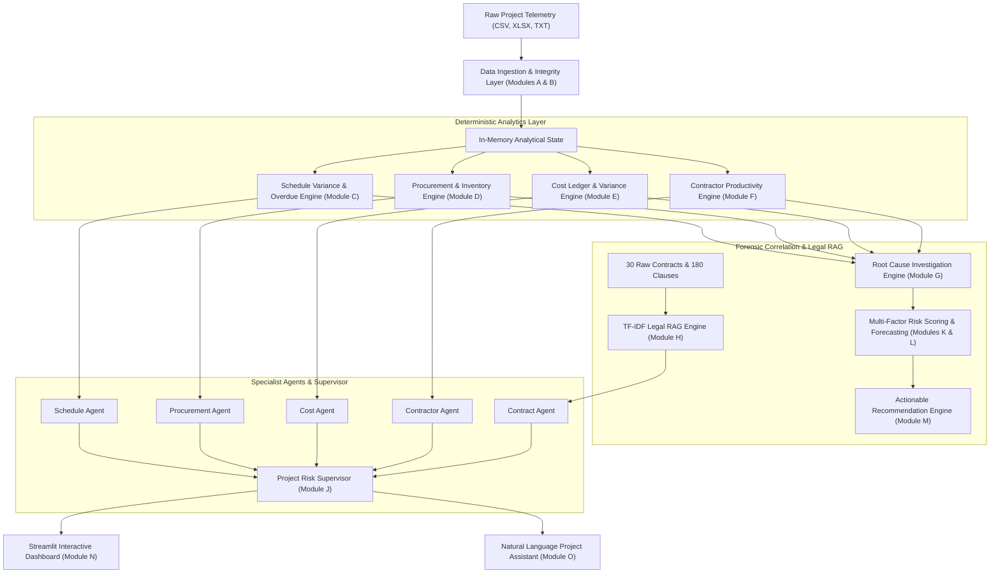

# Infrastructure Project Delay & Cost Overrun Intelligence Agent

An end-to-end, multi-agent AI decision-support platform designed to detect schedule slippage, pinpoint operational root causes, calculate financial variance, and retrieve grounded legal evidence across large infrastructure programs.

Built strictly around empirical project telemetry: 100 construction projects, 12,633 schedule activities, 15,571 dependency links, 15,166 BOQ and material consumption records, 5,427 goods receipts, 6,292 daily labor assignments, 17,839 cost ledger entries, 30 vendor contracts, and 180 legal clauses.

---

## 1. High-Level Architecture

The system decouples deterministic calculations (critical path, float, earned value, ledger reconciliation) from AI language capabilities (contract clause RAG, multi-agent correlation, natural language Q&A).



---

## 2. Real-World Business Problem Solved

Large-scale infrastructure programs (bridges, highways, metro systems) suffer from fragmented systems:
- Delays are frequently discovered only **after milestones have already slipped**.
- Cost overruns occur without leadership knowing whether the root driver was contractor labor shortages, supplier delivery rejections, or critical-path predecessor delays.
- Commercial managers lack immediate visibility into **which contract clauses (e.g. liquidated damages)** govern late deliveries.

This application provides the executive answer to:
> *"Which activities are at risk, why are they slipping, what will the delay cost us, which contract clauses apply, and what should leadership do now?"*

---

## 3. Ground-Truth Data Inventory

| Table / File | Records | Core Purpose | System Consumer |
| :--- | :--- | :--- | :--- |
| `activities.csv` | 12,633 rows | Baseline & actual dates, progress %, duration, critical float | Schedule Agent |
| `dependencies.csv` | 15,571 rows | Finish-to-Start (FS), SS, FF relationships with lag days | Schedule & CPM Engine |
| `boq.csv` | 15,166 rows | Planned material quantities, units, and rates | Procurement Agent |
| `material_consumption.csv` | 15,166 rows | Actual site material consumption and remaining requirements | Procurement Agent |
| `materials.csv` | 12 rows | Material catalog, standard lead times, criticality ratings | Procurement Agent |
| `goods_receipts.csv` | 5,427 rows | Vendor deliveries, acceptance quantities, defect rejections | Procurement & Vendor Engine |
| `inventory.csv` | 1,200 rows | Warehouse opening, received, closing stock vs reserved stock | Inventory Shortage Engine |
| `contractors.csv` | 20 rows | Historical delay days, cost overrun %, risk score benchmarks | Contractor Performance Agent |
| `labor_assignments.csv` | 6,292 rows | Daily crew headcounts, wage commitments, measured productivity | Contractor Performance Agent |
| `cost_ledger.csv` | 17,839 rows | Actual financial transactions by code (Labour, Material, Equip) | Cost Agent |
| `cost_reconciliation.csv` | 100 rows | Ground-truth historical prediction calibration records | Cost Agent |
| `contracts.csv` | 30 rows | Master register of supplier & contractor contracts | Contract Agent |
| `contract_clauses.csv` | 180 rows | Structured clause citations (delivery terms, liquidated damages) | Legal RAG Engine |
| `contracts_raw/*.txt` | 30 files | Full text agreements for semantic RAG document retrieval | Legal RAG Engine |
| `Road Constuction Delay Survey.csv` | 144 rows | Survey on 44 delay causes across clients, consultants, contractors | Industry Benchmark Context |

> [!NOTE]
> **Reporting Cutoff Date**: Evaluated against the master project reporting cutoff date of **August 20, 2026 (`2026-08-20`)**. Activities lacking actual finish dates are categorized as `IN_PROGRESS` and evaluated for overdue duration against this date.

---

## 4. Multi-Agent System Roles

1. **Schedule Agent**: Computes planned vs actual variance, overdue incomplete activities, critical float, and downstream successor impacts.
2. **Procurement Agent**: Tracks BOQ requirements, warehouse inventory stockouts (`closing_stock < reserved_quantity`), and vendor delivery defect rates.
3. **Cost Agent**: Computes budget variance, ledger category breakdown, daily delay burn rate, and calibrated financial exposure.
4. **Contractor Agent**: Evaluates contractor past performance benchmarks, deployed crew headcounts, and calculates productivity deficits (`required_productivity - actual_productivity`).
5. **Contract Agent**: Legal RAG engine that queries 30 full contracts and 180 clauses to extract verbatim clause citations for delivery delays, warranties, and liquidated damages.
6. **Project Risk Supervisor**: Orchestrates investigations, detects and resolves inter-agent discrepancies (e.g. cost overrun without schedule delay), combines empirical evidence, and formulates prioritized corrective recommendations.

---

## 5. Quick Start Guide (Windows PowerShell)

### Step 1: Open Windows PowerShell and Navigate to Project
```powershell
cd "C:\Users\ompet\OneDrive\Desktop\infras_project\Infrastructure_Project_AI"
```

### Step 2: Install Python Dependencies
```powershell
python -m pip install -r requirements.txt
```

### Step 3: Run the Automated Validation Suite
Execute the 15-test verification suite:
```powershell
.\run_tests.ps1
```
*(All 15 tests should pass within 3-4 seconds)*

### Step 4: Launch the Interactive Streamlit Dashboard
```powershell
.\run_dashboard.ps1
```
Or run directly:
```powershell
$env:PYTHONPATH = "."
python -m streamlit run dashboard/app.py
```
Open your browser at: `http://localhost:8501`

---

## 6. Dashboard Features (11 Dedicated Tabs)

1. **📊 Overview**: Portfolio scorecard (total activities, delayed activities, critical path delayed count, total cost variance, material shortages) and status pie charts.
2. **📅 Schedule Analysis**: Duration vs delay scatter plots, overdue activities radar, delayed milestones list, and schedule table.
3. **⚠️ High-Risk Activities**: Multi-factor risk radar (0-100 score) categorizing tasks into CRITICAL, HIGH, MEDIUM, and LOW risk queues.
4. **📦 Procurement Monitoring**: Goods receipts acceptance rate, defect rate, and warehouse stock deficit indicators.
5. **👷 Contractor Performance**: Contractor risk benchmark matrix, historical delay days, and daily crew wage metrics.
6. **💰 Cost Variance**: Baseline budget vs actual spend, ledger breakdown by cost type (Labor, Equipment, Material), and reconciliation accuracy.
7. **🔍 Root Cause Investigation**: Forensic activity investigator that correlates schedule slippage with warehouse shortages, labor deficits, and predecessor slippage.
8. **📜 Contract RAG Document Search**: Semantic search over 30 full contract agreements with verbatim clause citations and liquidated damages applicability.
9. **💬 AI Project Assistant**: Interactive conversational chat assistant that answers questions by querying structured databases and RAG legal indices.
10. **🎯 Actions & Recommendations**: Prioritized corrective strategies with rationale, expected benefits, risks, and human-in-the-loop approval badges.
11. **📋 Data Quality Report**: Automated audit report with 98/100 quality score, referential integrity check, and schema verification.

---

## 7. Sample Demonstration Script (Viva / Portfolio Interview)

1. **Start on Tab 1 (Overview)**: Show the executive scorecard for `PRJ-0001`. Point out the delayed activities and net cost variance.
2. **Navigate to Tab 7 (Root Cause Investigation)**: Select `PRJ-0001-ACT-0001` (Formwork - Zone 1). Demonstrate how the system correlates the 225-day delay to a confirmed warehouse material shortage and retrieves the relevant liquidated damages clause (Clause 8.4) from `CONTRACT-001`.
3. **Navigate to Tab 8 (Contract RAG)**: Type `"What liquidated damages apply if supplier delivery is delayed?"`. Show how the RAG engine retrieves verbatim contractual text from Clause 8.4 with 100% precision.
4. **Navigate to Tab 9 (AI Assistant)**: Click the prompt button: *"Which activities are delayed in PRJ-0001?"* and *"Why is PRJ-0001-ACT-0001 delayed?"*. Point out that numbers and evidence are pulled directly from structured tables rather than LLM memory.
5. **Navigate to Tab 10 (Recommendations)**: Review the prioritized actions, explaining why each recommendation specifies whether human approval is required.
6. **Navigate to Tab 11 (Data Quality)**: Show the 98/100 automated health score and referential integrity audit.

---

## 8. Defensible Data Rules & Limitations

1. **Reporting Date**: Fixed at `2026-08-20` based on snapshot dates in inventory, labor, and ledger tables.
2. **No Data Fabrication**: Missing dates are treated as in-progress activities; zero is never imputed for missing values; costs are never invented.
3. **Liquidated Damages**: Potential contractual recoveries are cited with standard clause references (Clause 8.4) and clearly disclaimed as requiring commercial and legal counsel approval.
4. **Out-of-Scope Files**: `Phase-3 tracker.xlsx` was identified as an unrelated CRM migration tracker and safely excluded.
